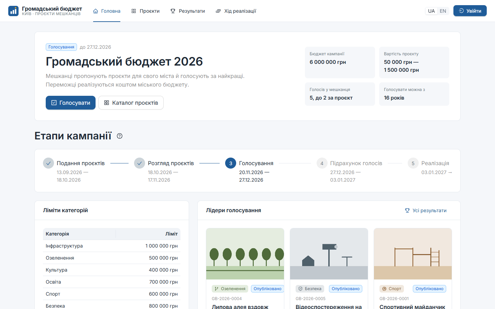
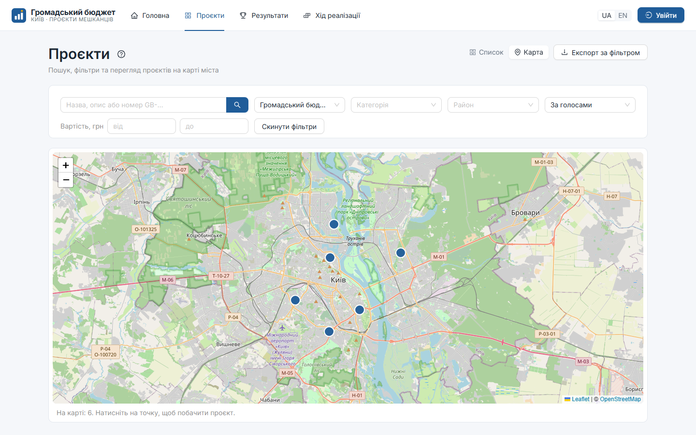
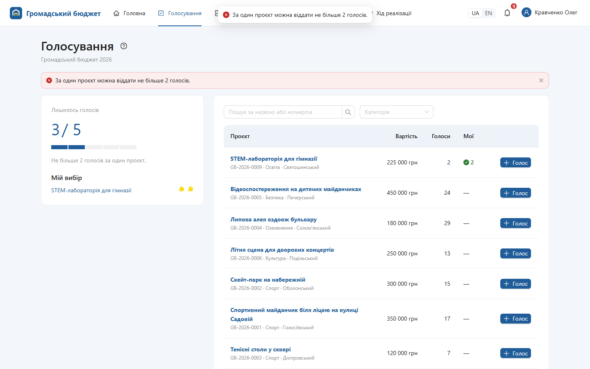
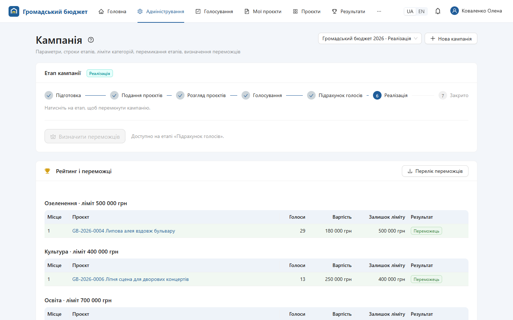
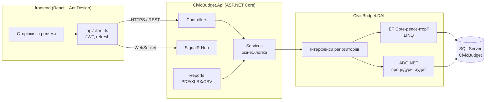

# Громадський бюджет

Інформаційна система обліку, голосування та реалізації проєктів громадського бюджету міста.
Мешканці подають проєкти, модератори й експерти їх розглядають, мешканці голосують онлайн або паперовими бюлетенями,
адміністратор визначає переможців у межах лімітів категорій, виконавці звітують про реалізацію.

Курсова робота з дисципліни «Технології розроблення програмного забезпечення», КПІ ім. Ігоря Сікорського, ФІОТ.
Автор — Литвиненко Ілля, ІК-43.

| | |
|---|---|
|  |  |
|  |  |

## Можливості

- **Відвідувач:** поточна кампанія та її етапи, каталог із пошуком, фільтрами й картою, картка проєкту, результати (оновлюються в реальному часі), хід реалізації, відкриті дані (JSON / CSV).
- **Мешканець / автор:** реєстрація через BankID / Дія.Підпис (імітація) з перевіркою міста й віку; проєкт із кошторисом, точкою на карті й вкладеннями; попередження про схожі проєкти; подання; доопрацювання; голосування (5 голосів, до 2 за проєкт); підписки й сповіщення.
- **Модератор:** черга, призначення відповідального, рішення (допустити / доопрацювати / відхилити / дублікат / на експертизу), публікація.
- **Експерт:** технічна, юридична, фінансова експертиза.
- **Оператор:** внесення паперового бюлетеня.
- **Виконавець:** етапи реалізації, звіти з фото.
- **Адміністратор:** параметри кампанії й ліміти категорій, перемикання етапів, визначення переможців, картки реалізації й прийняття звітів, звіти PDF / XLSX / CSV, статистика з діаграмами, користувачі й ролі, журнал аудиту.

Захист: HTTPS, JWT (access 15 хв, refresh 7 днів), BCrypt, ролі на кожному ендпоінті, блокування після 5 невдалих входів,
двофакторна автентифікація для працівників, обмеження частоти запитів, CSP і захисні заголовки, журнал доступу до персональних даних.

## Стек

| Шар | Технології |
|---|---|
| БД | MS SQL Server 2022 (Express): 20 таблиць, уявлення, тригери, збережені процедури |
| Доступ до даних | EF Core 8 (Database First) + ADO.NET, репозиторії з інтерфейсами |
| API | ASP.NET Core 8 Web API, REST/JSON, Swagger (OpenAPI 3), SignalR, QuestPDF, ClosedXML |
| Клієнт | React 18, TypeScript 5, Vite, Ant Design 5, Leaflet (OpenStreetMap), Recharts, i18next |
| Якість | ESLint, Prettier, `dotnet format`, `.editorconfig` |

Чому саме так і чим стек відрізняється від промислового варіанта з ТЗ — [docs/adr/0001-stack.md](docs/adr/0001-stack.md).

## Архітектура



- **DAL** (`CivicBudget.DAL`) — модель, згенерована з наявної БД (`Scaffold-DbContext`), репозиторії з інтерфейсами.
  Звичайні запити — EF Core і LINQ; збережені процедури `usp_SubmitProject`, `usp_SelectWinners` і журнал аудиту — ADO.NET.
- **Сервіси** (`CivicBudget.Api/Services`) — сценарії предметної області. Правила голосування й подання перевіряє БД (тригери, процедури);
  сервіси їх не дублюють, а перекладають `SqlException` 50001–50020 у зрозумілі повідомлення.
- **API** (`CivicBudget.Api/Controllers`) — тонкі контролери з перевіркою ролей; до даних звертаються лише через сервіси й репозиторії.
- **Клієнт** (`frontend`) — SPA, меню й сторінки залежать від ролей користувача.

## Швидкий старт

**Вимоги:** Windows, SQL Server 2022 Express (екземпляр `.\SQLEXPRESS`), .NET 8 SDK, Node.js 18+.

```bat
dotnet dev-certs https --trust   :: один раз: довіра до локального HTTPS-сертифіката
reset.bat                        :: створює БД CivicBudget і заливає демо-дані
start.bat                        :: запускає API і клієнт, відкриває https://localhost:5173
```

| Адреса | Що там |
|---|---|
| <https://localhost:5173> | застосунок |
| <https://localhost:7080/swagger> | Swagger UI (`POST /api/auth/login` → **Authorize**) |

Перед кожним показом запускайте `reset.bat`: дати в демо-даних рахуються від сьогодні, тож голосування завжди «триває».

### Конфігурація й секрети

У репозиторії немає секретів. `appsettings.json` містить лише заглушки:

| Параметр | Де задати |
|---|---|
| `Jwt:Key` (≥ 32 символи) | `dotnet user-secrets set "Jwt:Key" "<випадковий рядок>"` у `backend/CivicBudget.Api` або змінна середовища `Jwt__Key`. `start.bat` створює ключ автоматично, якщо його немає. |
| `ConnectionStrings:CivicBudget` | за замовчуванням `Server=.\SQLEXPRESS;…;Trusted_Connection=True` (вхід Windows, без пароля); інший сервер — змінна `ConnectionStrings__CivicBudget` |

Без `Jwt:Key` API не стартує й пише, що саме налаштувати.

### Пошта й 2FA в демо-режимі

Справжнього SMTP немає: листи (сповіщення про зміну статусу, коди 2FA) записуються файлами `.eml`
у `backend/CivicBudget.Api/mail-outbox/`. У адміністратора ввімкнено двофакторну автентифікацію;
у режимі Development сторінка введення коду показує шлях до цієї папки.

### Ручний запуск

```powershell
powershell -ExecutionPolicy Bypass -File db\reset.ps1      # БД + демо-файли
cd backend\CivicBudget.Api; dotnet run --launch-profile https
cd frontend; npm install; npm run dev
```

Або Visual Studio 2022: `backend/CivicBudget.sln`, стартовий проєкт `CivicBudget.Api`, профіль `https`.
На цьому стенді служба SQL Browser вимкнена, тому `sqlcmd` підключається через іменований канал:
`sqlcmd -S "np:\\.\pipe\MSSQL$SQLEXPRESS\sql\query" -E -C -i db\CivicBudget_create.sql`.

## Тести

```powershell
cd backend
dotnet test                                   # усі тести (потрібна БД CivicBudget у демо-стані — reset.bat)
dotnet test --filter Category!=Database       # лише модульні, без БД
```

- `ServiceRulesTests` — правила в сервісах (голосування, подання, модерація, дублікати, параметри кампанії, рейтинг переможців); репозиторії підмінено NSubstitute.
- `DatabaseRulesTests` — правила, які перевіряє БД: тригер `TR_Vote_CheckRules` (50001–50005), `usp_SubmitProject` (50012), `usp_SelectWinners` (ліміт категорії, 50020) і їхній переклад у повідомлення. Кожен тест працює у власній транзакції з відкатом.
- `ReportExporterTests` — експорт звітів у PDF, XLSX і CSV.

## Демо-облікові записи

Пароль для всіх: `Demo123!`. На сторінці входу є список: клік підставляє логін.

| Роль | E-mail | Для чого |
|---|---|---|
| Адміністратор (2FA) | admin@civicbudget.test | кампанія, переможці, звіти, статистика, користувачі, аудит |
| Модератор | moderator@civicbudget.test | черга модерації, публікація |
| Експерт | expert@civicbudget.test | висновок щодо проєкту на експертизі |
| Оператор | operator@civicbudget.test | паперовий бюлетень (виборець без голосів — «Гончаренко») |
| Виконавець | executor@civicbudget.test | етапи й звіти реалізації |
| Автор | author@civicbudget.test | чернетка, проєкт на доопрацюванні, подання |
| Мешканець | resident@civicbudget.test | ще не голосував |
| Мешканець, 15 років | teen@civicbudget.test | спроба голосу → відмова (50002) |
| Неверифікована | unverified@civicbudget.test | спроба голосу → відмова (50002) |

### Сценарій демонстрації (≈ 3 хв)

1. **Автор** → «Мої проєкти» → «STEM-лабораторія» (на доопрацюванні) → «Додати позицію» → «Подати повторно» → номер GB-2026-0009.
2. **Модератор** → «Модерація» → «Перевірити» → «Допустити» → вкладка «Допущені» → «Опублікувати».
3. **Мешканець** → «Голосування» → «+ Голос» двічі за STEM-лабораторію, третій раз — «За один проєкт можна віддати не більше 2 голосів».
4. **Адміністратор** (код 2FA з `mail-outbox`) → «Кампанія» → етап «Підрахунок голосів» → «Визначити переможців»:
   у «Спорті» скейт-парк (300 000 грн) не вміщується в залишок ліміту 250 000 грн, а тенісні столи (120 000 грн) проходять.
5. **Результати** → переможці позначені; «Експорт» → PDF.

## Структура

```
CivicBudget-TRPZ/
├─ backend/
│  ├─ CivicBudget.sln
│  ├─ CivicBudget.Tests/      xUnit: правила сервісів, правила БД, експорт звітів
│  ├─ CivicBudget.DAL/        Entities/ (scaffold), CivicBudgetContext, Models/, Repositories/ (EF), Sql/ (ADO.NET), Infrastructure/
│  └─ CivicBudget.Api/        Controllers/, Services/, Reports/, Dto/, Auth/, Hubs/, Infrastructure/
├─ frontend/src/              api/, auth/, components/, pages/, help/, locales/
├─ db/                        CivicBudget_create.sql, CivicBudget_demo.sql, reset.ps1, demo-files/
├─ docs/                      adr/, screens/
├─ start.bat, reset.bat
└─ .editorconfig
```

## Документація

- [docs/adr/0001-stack.md](docs/adr/0001-stack.md) — технологічний стек і відхилення від ТЗ
- [docs/screens/](docs/screens/) — скріни всіх форм (1440×900)
- Swagger — повний перелік ендпоінтів з описами: <https://localhost:7080/swagger>

### База даних: Database First

Модель EF Core згенеровано з наявної БД (Package Manager Console, Default project `CivicBudget.DAL`):

```powershell
Scaffold-DbContext "Server=.\SQLEXPRESS;Database=CivicBudget;Trusted_Connection=True;TrustServerCertificate=True;" Microsoft.EntityFrameworkCore.SqlServer -OutputDir Entities -Context CivicBudgetContext -ContextDir . -NoOnConfiguring -Force
```

Або `dotnet tool restore` і `dotnet ef dbcontext scaffold … --project CivicBudget.DAL --output-dir Entities --context CivicBudgetContext --context-dir . --no-onconfiguring --force`.
Пакет `Microsoft.EntityFrameworkCore.SqlServer.NetTopologySuite` потрібен, щоб колонка `Project.Location` (geography) потрапила в модель.

### Де в коді техніки доступу до даних

| Техніка | Файл |
|---|---|
| Database First, ORM | `backend/CivicBudget.DAL/CivicBudgetContext.cs`, `Entities/` |
| DAL: інтерфейси репозиторіїв | `CivicBudget.DAL/Repositories/Interfaces.cs` |
| LINQ-методи з лямбдами, `Skip/Take` → `OFFSET … FETCH` | `Repositories/ProjectRepository.cs` (`Filtered`, `SearchAsync`) |
| LINQ query-синтаксис `join … group … by … into`, left join | `Repositories/StatisticsRepository.cs`, `ImplementationRepository.cs` |
| ADO.NET, з'єднаний сценарій: `SqlCommand` (`StoredProcedure`) + `SqlDataReader` | `CivicBudget.DAL/Sql/ProcedureRepository.cs` |
| ADO.NET, від'єднаний сценарій: `SqlDataAdapter` → `DataTable` → `DataView` | `Sql/AuditRepository.cs` |
| `SqlException` 50001–50020 → повідомлення користувачу | `Infrastructure/BusinessRuleException.cs` (`DbErrors`) |
| `SESSION_CONTEXT` для тригера аудиту | `Infrastructure/SessionContextInterceptor.cs`, `Sql/SqlConnectionFactory.cs` |
