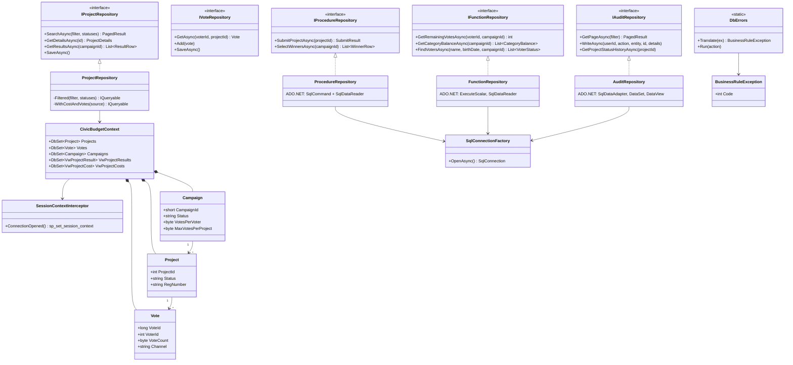
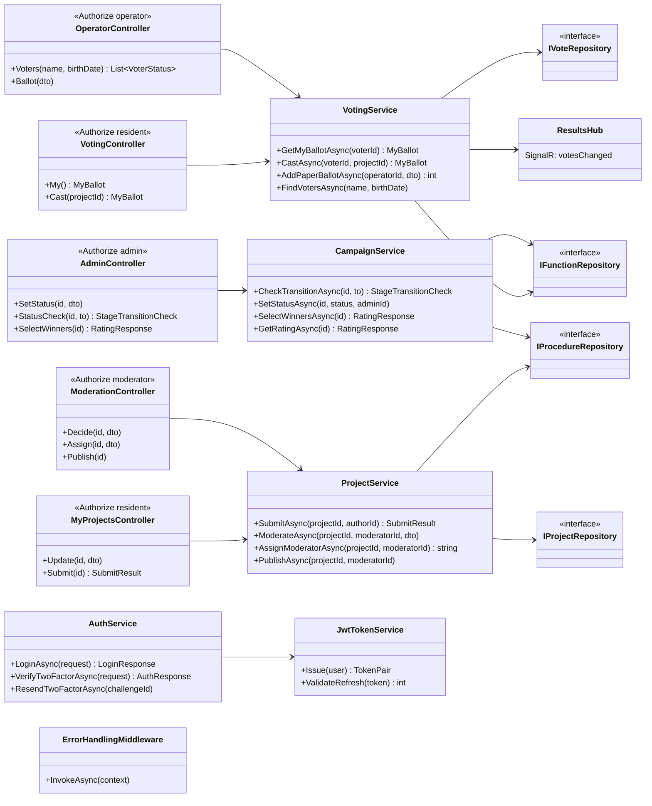

# Діаграма класів бекенду

Дві діаграми — фрагменти проєктів `CivicBudget.DAL` і `CivicBudget.Api`. Показано класи, через які проходять
основні сценарії (подання, голосування, визначення переможців); сутності EF — лише ті, що беруть участь у них.
Картинки: `class-dal.png`, `class-api.png` (згенеровано з цього файлу).

Позначення: `<|..` — реалізує інтерфейс, `-->` — використовує (залежність через конструктор), `*--` — композиція.

## Фрагмент DAL

## Фрагмент Api

Запит проходить шари так: контролер (перевірка ролі) → сервіс (бізнес-логіка) → репозиторій DAL (EF Core або ADO.NET) →
SQL Server (тригери, процедури, функції). Помилку з БД `DbErrors` перекладає в `BusinessRuleException`,
а `ErrorHandlingMiddleware` повертає її як HTTP 400 з текстом для користувача.
