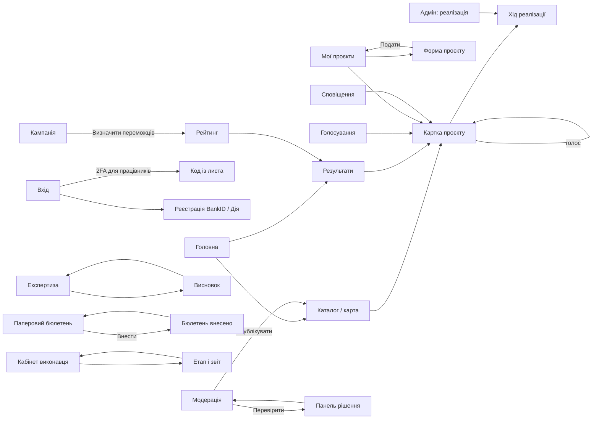

# Інтерфейс: меню, спливаючі меню, переходи між формами

## Головне меню за ролями

Меню будується з ролей користувача (RBAC, `AppLayout.tsx`, функція `useMenuItems`). Спершу пункти ролі (робочі сторінки),
потім публічні. Якщо ролей кілька, пункти кожної ролі зібрано в окреме підменю (наприклад, адміністратор, який є й мешканцем,
бачить «Адміністрування ▾» і «Мешканець ▾»). На екрані до 992 px меню відкривається кнопкою ☰ збоку.

| Роль | Пункти меню (крім публічних) | Сторінка після входу |
|---|---|---|
| Відвідувач (без входу) | Головна, Проєкти, Результати, Хід реалізації; кнопка «Увійти» | — |
| Мешканець / автор | Голосування, Мої проєкти | Голосування |
| Модератор | Модерація | Модерація |
| Експерт | Експертиза | Експертиза |
| Оператор | Паперові бюлетені | Паперові бюлетені |
| Виконавець | Кабінет виконавця | Кабінет виконавця |
| Адміністратор | Адміністрування ▾: Кампанія, Реалізація, Звіти, Статистика, Користувачі й ролі, Журнал аудиту | Кампанія |

Публічні пункти бачать усі: Головна, Проєкти, Результати, Хід реалізації. У підвалі: Відкриті дані, Довідка, API (Swagger).

## Шапка

| Елемент | Що робить |
|---|---|
| Логотип | перехід на головну |
| UA / EN | мова інтерфейсу (запам'ятовується в браузері) |
| Дзвіночок з лічильником | непрочитані сповіщення → сторінка «Сповіщення» |
| Ім'я користувача (спливаюче меню) | ПІБ і ролі; Сповіщення; Довідка; Вийти |

## Контекстні меню «⋯» у таблицях

| Сторінка | Пункти |
|---|---|
| Модерація | Перевірити; Призначити модератора (вручну або автоматично за завантаженістю); Відкрити картку |
| Мої проєкти (поданий проєкт) | Переглянути картку |
| Користувачі й ролі | Змінити ролі; Заблокувати / Розблокувати; Увімкнути 2FA; Вимкнути 2FA (недоступно для модератора, експерта, адміністратора) |
| Адміністратор: реалізація | Етапи і звіти; Публічна сторінка |

Інші спливаючі елементи: кнопка «Експорт» (PDF, Excel, CSV) на картці проєкту, каталозі, результатах і звітах;
кнопка «?» біля заголовка кожної форми відкриває довідку саме до неї; підтвердження небезпечних дій
(голос, публікація, відхилення, перемикання етапу, визначення переможців, блокування) з поясненням наслідків.

## Переходи між формами

Тупиків немає: на кожній формі є головне меню, а на внутрішніх сторінках — посилання «назад»
(«До каталогу», «Мої проєкти»). Якщо даних немає (немає кампанії, порожня черга), показується пояснення й кнопки, куди перейти.

## Стани сторінок

| Стан | Як виглядає |
|---|---|
| Завантаження | сірий скелет замість вмісту |
| Порожньо | ілюстрація й текст («Черга порожня», «Ви ще не створили жодного проєкту») |
| Помилка | повідомлення українською з бази або сервера, без технічних подробиць |
| Немає кампанії | «Зараз немає оголошеної кампанії» з переходом до результатів і реалізації |
